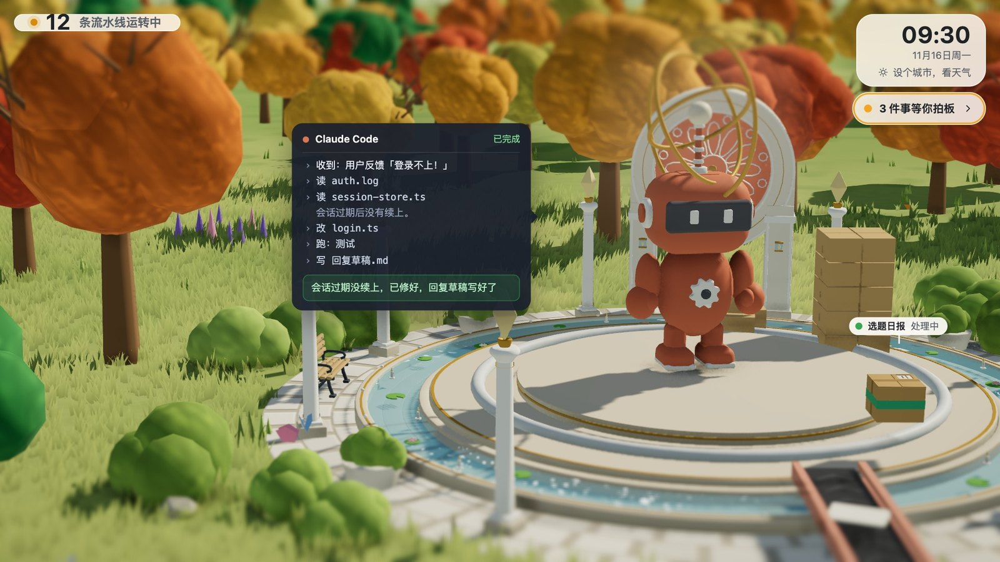

# 自动化小镇

给 [agent-autoloop](https://github.com/KKKKhazix/agent-autoloop) 做的 3D 看板：把中台里正在发生的事，画成一座移轴微缩小镇。事件是传送带上的包裹，Agent 站在自己的圆台上领活，需要你拍板时邮差骑车把卡片送到你家门口。

这是社区做的非官方项目，不属于 agent-autoloop，也和任何 Agent 产品的厂商无关。


上面是演示数据。[大图](docs/town.jpg) · [在线演示](https://flyhubs.github.io/agent-autoloop-town/)：不用装任何东西，演示数据全在你的浏览器里生成。

## 画的是什么

| 小镇里的 | 中台里的 |
|---|---|
| 中间的穹顶大厅：转盘，和绕着中柱转的三只分拣臂 | 中台：进来的事件等在转盘上；机械臂把包裹从传送带放上转盘，Agent 来领时再递到它那条带子上 |
| 西边的村子，每块地上一栋房子和一台机器 | 每条规则；同一个项目（规则的工作目录）的地块挨着，屋顶同色。房子按这条规则的事件从哪来分五种：定时的是钟表作坊（钟走真实时间），聊天和本机派活的是八角传话屋，代码仓库的是锯齿屋顶的代码工坊，告警的是带红白瞭望塔的值守站，别的外部服务是砖砌的收发站和卫星锅 |
| 东边一个个小广场上的吉祥物：环形水池中间的台子，一圈立柱灯，身后一道玫瑰窗拱门，头顶三道转着的金环 | 每个 Agent。拱门的玻璃是它自己的颜色；干活时金环转得快，一束光立在它身上 |
| 南边的邮局和小屋 | 通道，和你 |
| 传送带上的包裹 | 事件和一轮任务 |
| 骑车的邮差 | 发给你的卡片，和你的回答 |



只画中台日志里记了的事：小镇读的是中台的事实流，日志里没有的不画。池塘、鸟、街上散步的人和狗、天气、昼夜、四季是布景，不代表任何任务。

布景跟着真实的时间走：

- **一天**：日出日落前后各一个多小时，光线慢慢变，早晚是金色的斜阳和长影子，太阳从东边走到西边；天黑了路灯和窗户亮，晴夜有星星；清晨有一层薄雾，日出两小时后散。填了城市就按那里的日出日落，没填就按日历估（大约北纬三十几度）。
- **一年**：春天树发新叶、花树开花；夏天最绿；秋天变黄变红、落叶；冬天落光露出枝桠，只剩常青树。每棵树早几天晚几天，不会一夜全变。南半球的城市四季反过来。
- **雪**：下雪时积雪；填了城市，天气服务说那里地上有积雪，雪就一直留着。
- **远处**：镜头压低能看到地平线：镇外的树越来越稀，东北边一片湖，再远是三层山。

想马上看一遍：点右上的天气，卡片里有「快进一天」「快进一年」，各 24 秒，看完回到现在。

**回放今天**：工具栏里点「回放今天」，小镇把今天从零点到现在再过一遍。用的是中台自己的记录：每一轮什么时候来、什么时候被领走、什么时候做完，每张卡片什么时候发、什么时候答。没事的钟点一晃而过，有事的地方放慢；每个时刻小镇都摆成当时的样子：谁在干活、谁在排队、托盘上做完了几箱、门口几封信、告示牌上的数，时钟和天色跟着走。底下那条是今天：竖线是每一轮，圆点是卡片，可以拖，也可以用左右方向键（按住 Shift 一次一小时）。停在某一轮上，Agent 旁边的小窗是那一轮当时真实的步骤。点 × 或按 Esc 回到现在；回放的时候发生的事不画，回来时按中台的现状摆好。

中台广场边上立着一块**告示牌**，写的是中台今天记下的数：做完几件、花了多少、最忙的线、干得最多的 Agent、最爱卡的线（按中台还列着的最近几十轮算）。点中台，右边卡片里是同样几行。

任务行上的「会话」：这一轮是 Claude Code 做的、中台又留了会话号时，点一下复制 `claude --resume <会话号>`，在终端里粘贴就能接着那一轮往下聊；旁边的「打开」是中台给的 `claude://` 链接。

页面平时是安静的：左上一句「N 条流水线运转中」，右上时钟和天气，每条规则和每个 Agent 一块名牌，有事等你拍板时多一个提示。点左上那一句，展开清单、统计和工具栏：看每条规则和每个 Agent 的状态、看花了多少、回答等你拍板的卡片、翻全部任务、直接派一件活（可以带附件）；工具栏里「收起」回到安静的样子。

**跟着一件事看到底。** 事件进来时，接它的那台机器上会弹一句它说了什么；包裹带着一块小牌子（哪条规则、排队还是处理中）上传送带。点这个包裹或它的牌子，镜头就跟着它走：沿街进中台，分给 Agent，停在 Agent 面前看它做完，再回到全景。拖动画面或按 Esc 随时松开。点一个 Agent，镜头也会转过去。

**放着不管，让它自己演（导播）。** 地址里加 `?desk`，或者展开工具栏点「导播」：没事的时候镜头绕着小镇慢慢转；有事件进来，镜头自己跟上那个包裹，一路跟到 Agent 面前看它做完，再回来接着转。只跟中台记录了的事。你一碰画面它就松手，半分钟不碰再接着演。适合放在旁边的屏幕上当摆件。

**Agent 在做什么。** 镜头在 Agent 面前时，它旁边有一块像终端的小窗，一行行写着这一轮做到哪了：「读 auth.log」「改 login.ts」「跑：测试」，最后是这一轮自己的结论。这些是从本机接单程序留下的这一轮记录里读出来的（`<数据目录>/worker/runs/`），Claude Code 和 Codex 的记录都认。每一步只有文件名、程序名、上网搜的词、看的网页的域名，或者 Agent 自己对这一步的一句说明：读到和写进去的内容、命令的参数、设置和输出、在文件里搜的内容、所在的目录都不显示。Agent 自己说的话（包括最后的结论）是原样显示的，它可能引用看到的东西：把小镇放在别人看得见的屏幕上时留意这一点。这一轮不是在这台电脑上跑的，或者用的是别的 Agent 程序，就只显示收到了什么和最后的结论。

## 跑起来

需要 Node 24 或更新。没有任何依赖，不用 `npm install`。

```sh
git clone https://github.com/FlyHubs/agent-autoloop-town.git
cd agent-autoloop-town
node server.mjs --demo
```

打开 <http://127.0.0.1:3400>。`--demo` 用的是演示数据，不需要装中台，不花钱。

连你自己的中台：先照 [agent-autoloop 的说明](https://github.com/KKKKhazix/agent-autoloop#readme)装好并启动它，然后

```sh
node server.mjs
```

它读 `~/.agent-autoloop/config.json` 找到中台。数据目录在别处时用 `--home <目录>`，或者设环境变量 `AGENT_AUTOLOOP_HOME`。

连真实中台时，终端里打印的地址后面带着 `?k=` 和一长串字符：**用这个完整的地址打开**，不带它打不开。可以存成书签，重启后还是同一个。原因见下面的「安全」。

| 开关 | 作用 |
|---|---|
| `--demo` | 不连中台，用演示数据 |
| `--port 3400` | 换端口 |
| `--home <目录>` | 中台的数据目录 |
| `--no-feishu` | 不把飞书里发给机器人的消息当任务 |
| `--lark <程序>` | 换一个飞书命令行程序，默认 `lark-cli` |
| `--chat-idle 30` | 飞书、微信里隔多少分钟没动静，下一条消息算新的一件事（旧名 `--feishu-idle` 也认） |
| `--weixin-login` | 连一个微信：显示二维码，用手机微信扫码确认。见下面「在微信里派活」 |
| `--no-weixin` | 连过微信，但这次不听微信里的消息 |
| `--keep-days 30` | 工作目录里随任务来的附件、交回的成果留多少天；`0` 是一直留着 |

小镇服务要一直开着。想让它开机自己起来，用你系统的办法把上面那条命令登记成登录项（macOS 的 launchd、Linux 的 systemd 用户服务）。

## 在小镇里派活

点底部的「派活」，写一句话，就作为一条事件发给中台：来源是这台电脑自己的来源（默认叫 `local`），类型是 `task.new`。中台里要有一条接它的规则，在 `rules.json` 的 `rules` 里加：

```json
{
  "name": "临时任务",
  "when": { "source": "local", "types": ["task.new"] },
  "to": "claude",
  "cwd": "/你的/某个/工作目录",
  "parallel": 2,
  "resume": true,
  "prompt": "这一轮是本人在小镇或飞书里直接交代的任务。资料文件 events 里每条事件的 detail 就是任务原文，是本人亲手写的：照它做，一条事件一件任务。做完后，最后一条消息的第一行直接写做成了什么，这句话会发给本人；只有真的什么都没做才写“没事可做”。任务没说清就用 ask 问本人，不要自己猜。"
}
```

`to` 写你的 `agents` 里已有的名字。`parallel` 和 `resume` 让同一件事的几轮共用一个会话，不想要可以去掉。

注意这条规则把你写的字当成了指令：谁能往这个来源发事件，谁就能指挥这个 Agent。来源的密钥只在你这台电脑上，别给出去。

附件（点选、拖进来、粘贴截图都行）会被复制到规则工作目录的 `.town-inbox/时间戳/` 里，任务正文末尾自动附上清单。Word（.docx）、Excel（.xlsx）、PowerPoint（.pptx）还会在旁边多放一份转好的纯文字（`文件名.txt`），只能读文件、不能运行命令的 Agent 也读得了；PDF 和图片 Claude Code 自己就能读。老格式的 .doc、.xls、.ppt 不转。单个最多 20 MB，一件任务最多 8 个。这些目录和下面说的 `.town-outbox` 里的目录，过了 30 天会被小镇服务清掉（`--keep-days` 可以改）：要长期留的文件别只放在那里。

## 在飞书里派活

如果中台已经接了[飞书通道](https://github.com/KKKKhazix/agent-autoloop/blob/main/plugins/feishu/channel.ts)，并且 `config.json` 的 `channels.feishu` 里写了 `user`（你的 open_id），小镇服务会同时听你私聊机器人的消息，把它当任务派出去：

- 只认你本人、只认私聊；别人发的、群里发的都不理。超过 5 分钟才送达的消息不派。
- 图片和文件先发，再发文字，它们会随任务一起交给 Agent。
- 它在你那条消息下面回话：派给了谁；停下来问你时提醒一句；做完或没做成的结果。
- 30 分钟内的下一条消息接着上一件事；回复之前的某条任务消息是接着那一件；发「新话题」从头开始。
- 开头写「规则名：」可以指定规则。发「帮助」看说明，发「清空附件」丢掉还没用上的附件。
- Agent 放进工作目录 `.town-outbox/时间戳/` 的文件会发回给你。SVG 在 macOS 上会先转成 JPG 图片再发。

小镇服务重启不会丢事：还在做的任务接着盯，做完照样在原来那条消息下面回你，话题也接得上。它把这些记在中台数据目录的 `town/feishu.json` 里。一件任务最多盯一个小时。

不想要这个功能就加 `--no-feishu`。一个飞书应用的消息只能有一处在听，同一个应用不要开两个小镇。

## 在微信里派活

微信有官方的机器人接口（腾讯的 iLink，产品名「微信 ClawBot」）：扫码把你自己的微信连上，之后你在微信里发给 ClawBot 的消息，小镇当成任务派出去。消息是小镇主动去取的，这台电脑不需要公网地址。

```sh
node server.mjs --weixin-login     # 显示二维码；用手机微信扫，在手机上确认
node server.mjs                    # 然后照常启动（或重启）小镇
```

二维码会打印在终端里，同时在浏览器里打开一份（`--no-open` 不自动打开）。**扫码的那个微信，就是能给小镇派活的那个微信**，别让别人扫。手机上如果显示一串数字，照提示输入；终端里输入不了，就另开一个终端运行 `node server.mjs --weixin-pin 那串数字`。

用法和飞书里一样：直接发文字就是派活；图片和文件先发，再发文字；30 分钟内的下一条接着上一件事，发「新话题」从头开始；「规则名：」指定规则；「帮助」看说明。Agent 放进 `.town-outbox` 的文件会发回来；它要说的话不止一句时会写进那里的「回复.md」，小镇把内容当文字发给你（飞书里也一样）。语音按微信转出的文字算，没转出文字的语音不接。

和飞书不一样的地方：

- 微信里只有一个聊天窗口，回话不会挂在某条消息下面，所以每条回话开头会带上任务的前几个字，比如「帮我整理一下 README」✅ 做完了：……
- 微信里显示不了卡片。Agent 停下来问你时，小镇把问题和选项写成文字发给你：回一个数字就是选那一项；想说别的，回「#问题编号 你的话」。数字只有单独出现才算选项，「#12 1 个月以前的才删」是一句话。问题之后这个聊天里要是又说过别的话，裸数字就不认了，要写成「#问题编号 数字」：免得一个数字答到了别的事上。问题会一直等你，最多三天；只有在这个聊天里问出来、还没答的问题才认。
- Agent 写的字和小镇自己的话分得开：问题里它写的部分每行前面有一道竖线，它的回复每一段开头都标着「Agent 的回复」。
- 小镇只能在你发过消息之后回话（接口要带上你上一条消息附的凭据）。所以刚连上要先发一条消息；别的规则自己问出来的卡片，现在不会发到微信。
- 只能私聊，不能拉进群：腾讯的接口目前不开放群聊，群里也邀请不了它（试过）。
- 据官方仓库里别人的报告（我们没核实），你大约 15–24 小时没给它发消息后，它就回不了话了；还有人遇到过发送显示成功、手机上却没收到。所以别指望它隔天主动找你，结果没到时先在小镇里看。
- 一个机器人的消息只能有一处在取：同一次登录不要给两个程序用。
- 登录会过期。过期后小镇的日志里会说，重新运行 `--weixin-login` 扫一次码，再重启小镇。

这个接口是腾讯给 AI 助手接入用的，有它自己的使用条款，腾讯可以限速、调整或停掉它：别把离不开的事只押在这一条路上。小镇照腾讯公开的协议说明直接和它说话，没有用非官方的协议。

## 在聊天里给电脑上开着的会话传话（试验）

**这是试验性的功能**：默认关着，只在你自己写了下面的名单文件之后才开；它依赖 Claude Code 较新的会话互发消息功能，作者自己还没在真实微信里用过。

电脑上开着的 Claude Code 会话（比如一个叫「主控」的）可以从飞书或微信里叫到：发「@主控 帮我看看部署好了没有」，小镇把这句话原样转给那个会话；它在自己的上下文、用自己的权限去做，做完回一句话，小镇再转回聊天里，每一行都标明是那个会话说的。

先列出允许叫到的会话，按名字（就是 `claude --name` 或 `/rename` 起的名字），写进 `<数据目录>/town/sessions.json`：

```json
{ "names": ["主控"] }
```

重启小镇后它会在后台留一个自己的 Claude Code 进程（名字是「小镇传话」，用 Haiku，只给它发消息和列会话两样工具，不连任何 MCP），专门替你递话。没有这个文件就什么都不开；`--no-sessions` 临时关掉；`--claude <程序>` 指定用哪个 `claude`。

- **话是原样到的**：这个进程每发一条消息之前，都要过一道小镇自己的关卡（`session-gate.mjs`，Claude Code 的 PreToolUse 钩子）：只有小镇刚交代的那一条、一字不差、发给名单上的那个会话，才放行，而且只放一次。模型改不了你的话，也没法自己去回别的会话。
- **关卡坏了就不传**：Claude Code 在钩子跑不起来时会放行，所以关卡跑不起来时由命令自己说「不」；每次启动先自检（让它没许可就发一条，必须看到关卡拦下，一轮 Haiku 不到一美分），没通过就不开；万一有一条没经许可的消息发出去了，传话就关掉，要重启小镇才再开。
- **回话是原样回来的**：会话回给「小镇传话」的话，小镇从 Claude Code 记下的原文里取，不经模型转述。发送方的名字是对方自己报的，本机任何程序都能起一个同名的会话，所以每次传话都带一个一次性的回执码，只转第一行带着这个回执、来自那个会话、一天之内的话，一次传话最多转三条；没带回执的会告诉你一声，不转。
- **会话那边照它自己的规矩办**：要批准的操作会停在电脑上那个会话里等你；它会把这件事写进回话。Claude Code 会提醒收到的会话「这是别的会话发来的、不是你的用户亲手打的」，所以它多半会照做，但也可能先问。
- 会话之间互发消息是 Claude Code 比较新的功能，文档不多，以后可能会变。每递一句、每收一句，「小镇传话」都要用 Haiku 跑一轮，一轮不到一美分；回话的会话用它自己的模型。
- 这些防的是别的会话，和没有命令行、读不了文件的 Agent；不防你自己账户下能跑命令或读文件的程序（包括这样的 Agent）：它们能起一个也叫「小镇传话」的会话以你的口吻给名单上的会话发话，也能读到小镇的文件和 Claude Code 的会话记录（`~/.claude/projects/` 里，有你转的话和回执码）。所以**名单上的会话不要开着跳过权限确认的模式**（`--dangerously-skip-permissions` 或 bypassPermissions）：它收到的话要当成「多半是本人说的」，而不是「一定是」。
- 「小镇传话」照常读你自己的 Claude Code 设置和 CLAUDE.md，但启动时要它报出自己有哪些工具：除了发消息和列会话还有别的（比如插件带来的 MCP 工具），传话就不开。它在关卡之外只能列出会话；消息只发给这台电脑上的会话（启动时设了 `CLAUDE_CODE_DISABLE_NONESSENTIAL_TRAFFIC=1`）。
- 关卡每次运行都会留一个只有你读得到的记号；开机自检和每一条放行的消息都要看到这个记号，看不到就当关卡没在跑，传话关掉。自检连着三次没做成（模型不去发、发错了，或者两分钟没做完）就歇一小时再试，再不行歇得更久，最长一天：不会每隔几分钟花一轮 Haiku 一直试下去。网络一时不通、Claude Code 起不来，不花钱，它会自己接着试。一个数据目录同时只能有一个小镇在传话。
- 被叫的会话权限模式和「小镇传话」不一样时，Claude Code 可能把回话扣下等批准，后台进程没人批准，这条回话就到不了；小镇现在看不出这种情况。

## 安全

小镇页面能替你派活、替你回答卡片，等于你在中台上的一双手。所以：

- 只听 `127.0.0.1`，别的电脑连不上。不要用反向代理或内网穿透把它放到网上。
- 连真实中台时，页面只交给地址里带着钥匙的人。钥匙第一次启动时生成，存在中台数据目录的 `town/key` 里（只有你能读），启动时连同地址一起打印。这台电脑上别的用户、读不到那个文件的程序，打不开页面。和你同一个用户、不受限制的程序本来就能直接读中台自己的密钥，这一层不防它们。
- 中台「本人」的密钥留在小镇服务的进程里，不进页面。页面每次启动另拿一个随机口令，别的网站替你发请求过不了；页面里只有服务端标记过的脚本能运行。
- 传上来的附件只是被复制到工作目录，小镇服务不打开、不执行它们。
- 发回飞书的只有成果目录里的普通文件，而且是先复制出来再发：链接、文件夹、管道、别处文件的硬链接一律跳过，成果目录被换成链接就什么都不发。SVG 转图片时会交给 macOS 自带的 `sips` 解析。
- 微信的登录凭据存在中台数据目录的 `town/weixin-login.json` 里（只有你能读），不打印、不进日志。拿到它的人能读你发给 ClawBot 的消息、能以它的名义跟你说话（也就能冒充小镇），但不能给小镇派活：派活只认扫码的那个微信发来的消息。登录用的二维码在扫完之前也是同样要紧的东西，别让别人扫，也别让别人看到。
- 微信里回答问题，是小镇以你的名义把答案交给中台。它只对在这个聊天里写出来、还开着的问题这样做，只认扫码的那个微信。
- 除了中台，它只在三种时候联网：你在页面里填了城市，它向 [Open-Meteo](https://open-meteo.com/) 查那个城市的天气；开着飞书派活，它通过飞书命令行收发你和机器人的私聊；连了微信，它向腾讯的 `ilinkai.weixin.qq.com` 和它指定的存储地址收发你和 ClawBot 的消息、图片和文件。

发现安全问题请直接提 Issue，或者先私下联系仓库的主人。

## 已知的限制

- 只在 macOS 上、用 Chrome 系浏览器实际跑过。别的系统上没有测试过。
- 需要支持 WebGL 2 的浏览器和一块不太老的显卡。画得慢时页面会自己逐级让步：先降清晰度（低于每秒 40 帧时，最低到每个点一个像素），还不够（低于 26 帧）再依次少画远处的草、关掉贴地的柔和阴影、关掉草、关掉清晰阴影和光晕。在 4.5K 屏的 M4 iMac 上，默认设置约每秒 30 帧，清晰度降到 1 后约 39 帧（这是加五种房子、行人之前量的，之后没在那台机器上再量）。
- 界面只有中文。
- 微信这条路在一个真实微信上跑过这些：扫码绑定、收文字、回话、派活、接着上一件事做、收图片和 Word 文件、长回答、回数字答问题、把文件发回微信。还没在真实微信上核对过的：发回去的图片在手机上的样子、隔很久之后还能不能回话、收语音。
- 还没发出去就在等的附件（先发了图片、还没发文字）只在内存里，小镇服务重启后要重发。

## 自己改

```sh
node test/feishu-bridge.test.mjs      # 飞书桥的测试：假中台加假飞书命令行，不联网，不花钱
node test/weixin-bridge.test.mjs      # 微信这一路的测试：假中台加假的腾讯服务端，不联网，不花钱
node test/weixin-safety.test.mjs      # 微信这一路的安全测试：没送到的问题、Agent 冒充小镇说话、拖慢小镇的附件
node test/office-text.test.mjs        # 把 Word、Excel、PowerPoint 转成文字的测试，含坏文件、解压炸弹和故意读得慢的文件
node test/sessions.test.mjs           # 给电脑上的会话传话的测试：假的 Claude Code（test/fake-claude.mjs）走真的关卡
node test/run-steps.test.mjs          # 把一轮的记录读成「读了什么、改了什么、跑了什么」的测试：不漏内容、不出目录
node test/day.test.mjs                # 回放今天要用的那份时刻表：翻页、跨午夜、不带轮次里说了什么
bash tools/snap.sh /tmp/a.png '0'     # 无头浏览器打开演示小镇、截图，并打印页面报错
bash tools/fps.sh 3400 现在 '0'        # 测两秒平均帧数
```

截图和测帧数的工具需要一个无头 Chromium：`npx playwright install chromium-headless-shell` 装一个，或者用环境变量 `TOWN_CHROME` 指定。它们默认连 3401 端口，先用 `node server.mjs --demo --port 3401` 起一个演示小镇；要对着真实中台的小镇用，把带钥匙的完整地址作为最后一个参数传进去。

页面里有一组调试入口，在浏览器控制台里用：`TOWN.view(从哪看, 看哪)`、`TOWN.look("day" | "night" | "auto")`、`TOWN.sky("clear" | "rain" | "snow" | …)`、`TOWN.errors`、`TOWN.models()`、`TOWN.frames()`。地址后面加 `?plain` 用早期的简单模型，加 `?yards` 用改成村子之前的车间布局；加 `&fps`（地址里还没有 `?` 时写 `?fps`）在页面左下角显示每秒多少帧、清晰度、画质自动降了几级、页面自己报了几个错；`&ratio=1` 这样固定清晰度（每个点画几个像素，默认最多 1.5）；`&ao=full` 或 `&ao=off` 改物体贴地处的柔和阴影（默认按一半分辨率算，看不出区别，省一些）。

文件就这几个：`server.mjs` 是服务，`diorama.html` 和 `diorama.js` 是页面，`models/` 是模型，`vendor/three/` 是随仓库带的 three.js。`day.mjs` 把中台一天的轮次和卡片削成只剩时刻（给回放用，轮次里说了什么不带），`office-text.mjs` 把 Word、Excel、PowerPoint 里的文字取出来（零依赖，自己解 zip），`weixin.mjs` 是和腾讯 iLink 接口说话的那一层，`qr.mjs` 画登录用的二维码，`sessions.mjs` 和 `session-gate.mjs` 是给电脑上的会话传话的那个进程和它的关卡，`run-steps.mjs` 把一轮的记录读成几个字一步。`demo-world.mjs` 生成演示数据，服务的 `--demo` 和浏览器共用。`demo-static.mjs` 和 `index.html` 让页面在没有服务的地方也能打开（在线演示就是把仓库原样放到静态站点上）：那时它用演示数据，派活、回答卡片都只在你的浏览器里发生。

想给某种 Agent 换一个自己的形象：把 GLB 放进 `models/`，起名 `agent_claude.glb` 或 `agent_codex.glb`，页面会用它代替那种 Agent 的机器人。模型里叫 `body` 的部件会跟着动作跳，叫 `spark` 的会亮。

## 致谢

- 小镇的样子——移轴微缩、玻璃穹顶居中、一边车间一边 Agent——出自 agent-autoloop 的作者[数字生命卡兹克展示过的小镇](https://x.com/Khazix0918/status/2112838884510048647)。这里的代码和模型是照着那个方向另外写、另外建的。
- [agent-autoloop](https://github.com/KKKKhazix/agent-autoloop)：小镇只是它的一个客户端，用的是它公开的接口。
- [three.js](https://threejs.org/)（MIT，许可证在 `vendor/three/LICENSE`）。
- 微信的接法照的是腾讯公开的协议说明和他们 MIT 许可的客户端 [openclaw-weixin](https://github.com/Tencent/openclaw-weixin)。
- 模型由 Codex 按文字说明写 Blender 脚本生成。天气数据来自 [Open-Meteo](https://open-meteo.com/)。

## 许可证

[MIT](LICENSE)，代码和模型都是。
